---

## About Me

I’m a full-stack developer and Information Technology student based in Santa Cruz, Laguna, Philippines. I build web and mobile applications, administrative tools, and business systems, taking projects from interface design and data modeling through implementation, testing, and deployment.

My work includes e-commerce and small-business websites, management dashboards, civic and document workflows, appointment tools, and AI-assisted features. I enjoy turning practical needs into clear, maintainable software and continuing to learn from each project.

## Areas of Hands-On Experience

- **Frontend:** responsive interfaces, reusable components, interactive experiences, and accessibility-minded layouts
- **Backend:** REST APIs, server-side application logic, form handling, and third-party service integrations
- **Data and access:** relational database design, authentication, role-based access, and record-management workflows
- **Business systems:** dashboards, document requests, approvals, scheduling, order flows, and reporting
- **Mobile:** cross-platform app development with Flutter and Dart
- **Delivery:** Git-based collaboration, deployment, media handling, and browser-based testing
- **PC hardware:** PC assembly, component compatibility, upgrades, troubleshooting, and basic Windows/driver maintenance

## Technology Stack

### Frontend and UI

   HTML5 &nbsp;
   CSS3 &nbsp;
   JavaScript &nbsp;
   TypeScript &nbsp;
   React &nbsp;
   Next.js &nbsp;
   Vite &nbsp;
   Tailwind CSS &nbsp;
   Bootstrap &nbsp;
   GSAP &nbsp;
   Three.js &nbsp;
   React Router &nbsp;
   Lucide

### Backend and APIs

   Node.js &nbsp;
   PHP &nbsp;
   Laravel &nbsp;
   Python &nbsp;
   Flask &nbsp;
   Java

### Data and Cloud Services

   PostgreSQL &nbsp;
   MySQL &nbsp;
   Supabase &nbsp;
   Firebase &nbsp;
   Cloudinary &nbsp;
   AWS &nbsp;
   Cloudflare &nbsp;
   Vercel

### Mobile, Development, and Testing

   Flutter &nbsp;
   Dart &nbsp;
   Android Studio &nbsp;
   Docker &nbsp;
   Git &nbsp;
   GitHub &nbsp;
   VS Code &nbsp;
   Playwright

## Selected Projects

### Santa Cruz Connect

**Civic engagement · Web and mobile**

A community platform for local announcements, resident concerns, service requests, status tracking, and emergency reporting, with an AI assistant called **Kuya Pedro AI**.

### Smile & Co Dental Clinic Management System

**Healthcare operations · Web application**

A clinic-management concept covering appointment booking, patient records, treatment tracking, staff scheduling, and an AI-assisted inquiry flow.

### Veyron E-Commerce Platform

**Marketplace · Web and mobile**

A multi-role marketplace concept for buyers, sellers, and administrators, with product discovery, order tracking, chat, notifications, sales summaries, and receipts.

### Poblacion II Barangay Management System

**Government services · Web application**

A document-request and resident-management system with application tracking, approval workflows, standardized document generation, role-based access, and audit trails.

## Certifications

- AI Awareness — ASEAN Foundation
- Data Analytics Essentials — Cisco Networking Academy
- Python Essentials — Cisco Networking Academy
- IT Essential Skills — Village 88
- Navigating Digital Risk — PICPA Batangas
- IT Environment, the IT Profession and World of Compliance — PHINMA

## Currently Learning

I’m strengthening my foundations in **cybersecurity**, **data analytics**, and **software architecture**. I’m especially interested in applying secure development practices to systems that handle personal records, transactions, and community services.

## Contact

  
  &nbsp;&nbsp;
  
  &nbsp;&nbsp;
  

---

Open to thoughtful collaborations, freelance projects, and opportunities to keep growing.

